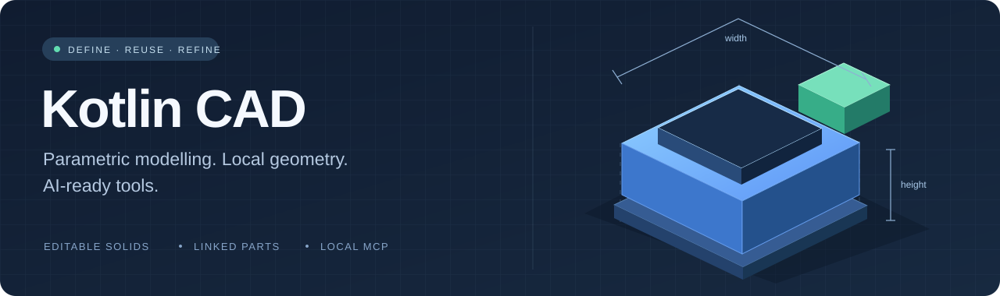
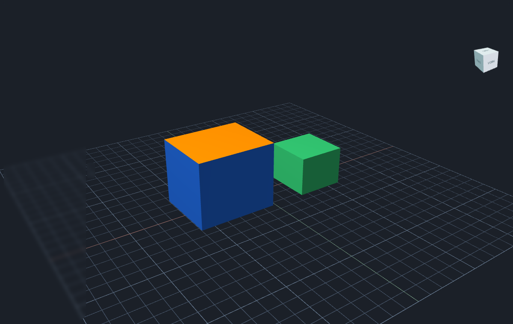
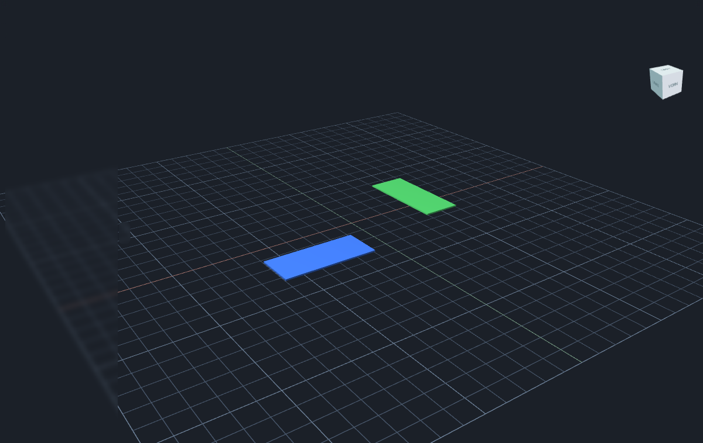

# Kotlin CAD



A local desktop CAD application built with Kotlin, Compose Desktop, JavaFX and
OpenCascade. The interface currently uses German labels. macOS is the tested
platform; native packaging targets the host architecture.

<table>
<tr>
<td width="50%"></td>
<td width="50%"></td>
</tr>
<tr>
<td><strong>Make every part readable</strong><br/>Assign colors to entire objects or individual surface areas.</td>
<td><strong>Define once. Reuse throughout.</strong><br/>Place linked, rotated parts and inspect them in an exploded view.</td>
</tr>
</table>

<sub>Actual viewport captures of synthetic demo models. The banner is an illustration.</sub>

[Features](#features) · [Build](#build-and-test) · [MCP](#mcp) · [AI setup](docs/ai-setup.md) · [Assembly guide](docs/modular-assemblies.md)

## Features

- Parametric primitives, sketches, extrusions with holes, constructive solids,
  Boolean operations, fillets, chamfers and elliptical-section lofts.
- Editable expressions, named parameters, stable feature IDs, undo/redo and
  self-contained `.kcad` projects.
- Linked, rotated part instances; atomic batch transactions; bounded geometry
  caching; background progress and cancellation.
- Object and area colors, STL/OBJ import/export, selected-part export and temporary
  print orientations.
- Insertion/removal path screening, sampled manufacturing checks, exploded views,
  part counts and revision comparison.
- Local MCP adapter and optional in-app AI assistant. The assistant requires the
  user's own supported Codex installation and sign-in; no account or credentials
  are included in this repository.

See [assembly documentation](docs/modular-assemblies.md),
[color documentation](docs/object-colors.md), and the exact tool definitions in
[docs/api](docs/api). Engineering screening does not certify strength,
printability, elastic assembly or mechanical retention.

## Build and test

Prerequisites:

- JDK 17 and Python 3 (build/testing helpers only).
- CMake 3.22+, Ninja, a C++17 compiler, and Eigen **5.0.1** with its CMake config.
- On macOS, command-line developer tools and Homebrew can supply the native tools.
  If Eigen is installed elsewhere, set `CAD_EIGEN_PREFIX` to its installation prefix.

```sh
./scripts/build-native.sh
./gradlew test installDist
./gradlew run
```

The native build downloads OpenCascade **8.0.1** from its upstream release tag and
verifies its checksum. The Gradle wrapper and distribution are checksum-pinned.
Native library versions are deliberately exact; the build rejects other versions.
The runtime uses the bundled geometry worker; Python is not required by the app.

Tests generate simple synthetic fixtures under ignored `samples/`. No private
CAD projects or model assets are distributed; the README images show only synthetic demos. Run `python3 scripts/generate_test_fixtures.py`
before optional standalone fixture-based scripts. Installed-viewer acceptance
scripts require an empty test session and an explicitly supplied project to restore;
read their preconditions before using them. They are not run automatically by CI.

## Package for macOS

```sh
./package-macos.sh
# Optional explicit installation:
./package-macos.sh --install
```

The default creates `build/releases/Kotlin CAD.app` without replacing your installed
app. Move an existing release bundle aside before packaging again. Local bundles
are not notarized developer releases. Do not publish local bundles, caches or logs
without a separate binary/artifact review.

## AI modelling workflow

The bundled [modelling skill](skills/kotlin-cad-projects/SKILL.md) gives agents a
standard project layout, editable models, numbered revisions and handoff notes.
It includes a project initializer, checkpoint helper and local MCP client.
See [AI setup](docs/ai-setup.md) for installation and usage. The root
[AGENTS.md](AGENTS.md) routes modelling and application-development work separately.
No personal configuration or saved projects are included.

## MCP

After installing and opening the app, configure an MCP client to launch:

```sh
./start-mcp.sh
```

The default app location is `~/Applications/Kotlin CAD.app`; `KOTLIN_CAD_APP` can
select another app bundle. `scripts/mcp_client.py` provides a small local protocol
client. MCP access can read and modify the live document and access paths accepted
by file tools; only connect clients you trust. Do not expose the local bridge as a
public network service.

`examples/construction_parts.py` demonstrates construction in an empty project.
[Assembly documentation](docs/modular-assemblies.md#minimal-batch-example) contains
an atomic batch example with linked parts.

## Source publication safety

```sh
python3 scripts/check_secrets.py
```

The check scans source and already-tracked ignored files, checks common credential
formats and personal home paths, verifies the wrapper, and rejects model assets
and unexpected binaries. CI runs this check for pushes and pull requests.
No scanner can prove that every possible secret is absent: review files before
publishing. Keep designs, exports, assistant sessions and credentials outside Git.
This source release excludes local model folders, recovery data, session handoffs,
build outputs and account state. There is no imported development Git history.

## License

Project source is licensed under [MIT](LICENSE). Third-party components retain
their own licenses; see [THIRD_PARTY_NOTICES.md](THIRD_PARTY_NOTICES.md).
